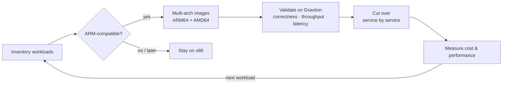

# AWS Graviton Migration

 -lightgrey) 

> **Architecture write-up.** This documents a system I designed and built as a DevOps Engineer at Faclon Labs (Mumbai). The implementation belongs to my employer and is not published; what follows is the design, the moving parts and the outcomes, with internal names and details left out.

Compatible compute workloads moved from x86-64 to ARM-based AWS Graviton
instances, with multi-architecture container builds so the same service runs
on either. EC2 cost fell by **~40% (about $3K per month)** with throughput
and latency unchanged.

## The problem

The EC2 bill was dominated by x86 instances running Python services that had
no particular reason to be on x86. Graviton offered the same work for less,
but only if every image, dependency and pipeline could produce and run ARM
builds reliably.

## Approach

1. **Inventory** every service and its native dependencies; flag anything
   without ARM wheels or with architecture-specific code.
2. **Build for both** — the CI pipeline produces ARM64 and AMD64 images under
   one manifest (see the multi-architecture CI/CD write-up), so cut-over is a
   scheduling decision, not a rebuild.
3. **Validate** each service on Graviton against its x86 twin: functional
   tests, then throughput and latency under production-like load.
4. **Cut over** one service at a time behind the same load balancer / queue,
   with the x86 path kept until the ARM path has run clean.
5. **Measure**, then repeat for the next workload.

## Outcomes

- **~40% EC2 cost reduction**, about **$3K/month**.
- No impact on throughput or latency.
- Multi-architecture builds became the default for every service.

## Stack

AWS EC2 (Graviton / ARM64 and x86) · Docker multi-arch builds · Jenkins · Prometheus / Grafana for before-and-after measurement

## My role

Led the migration: compatibility assessment, build strategy, validation and
the service-by-service cut-over.
